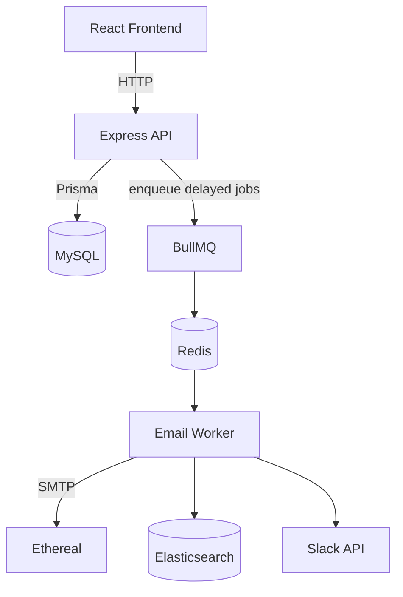

# ReachInbox Email Scheduler

A production-style full-stack email scheduling platform built with:
- React
- TypeScript
- Tailwind CSS
- Node.js
- Express
- MySQL
- Prisma
- Redis
- BullMQ
- Elasticsearch
- Ethereal SMTP

The application will support:
- Google OAuth
- Email scheduling
- CSV recipient upload
- BullMQ delayed jobs
- Redis rate limiting
- Slack notifications
- Elasticsearch search
- Bull Board
- Email history

## Local Development

The root `docker-compose.yml` starts local dependencies only: MySQL 8, Redis, and Elasticsearch. The MySQL credentials in the root `.env.example` are for local development only.

```bash
cp .env.example .env
cp backend/.env.example backend/.env
docker compose up -d mysql redis elasticsearch
```

The root `.env` configures Compose; `backend/.env` configures a backend process started directly on the host. When using Compose networking, set the backend's `DATABASE_URL` and `REDIS_URL` to the Compose service hostnames instead of `localhost`.

Install and run the API, worker, and frontend in separate terminals:

```bash
cd backend
npm ci
npm run build
npm run migrate:deploy
npm start
```

```bash
cd backend
npm run start:worker
```

```bash
cd frontend
npm ci
npm run build
npm start
```

The frontend preview is available at `http://localhost:4173`; Vite's development server is available at `http://localhost:5173`.

## Production Deployment

Use a supported Node.js 22 runtime. The API and BullMQ worker are separate processes and must both be deployed; do not expect the Express API process to run email jobs. Deploy MySQL, Redis, and Elasticsearch as reachable services. Do not use the local Compose credentials in production.

1. Install dependencies and generate the Prisma client:

	```bash
	cd backend
	npm ci
	npm run build
	```

	```bash
	cd frontend
	npm ci
	npm run build
	```

2. Configure the backend environment before migration or startup. Required infrastructure settings are `DATABASE_URL`, `REDIS_URL`, and `ELASTICSEARCH_URL`. Also set a strong `JWT_SECRET`, `FRONTEND_URL`, `BACKEND_URL`, Google and Slack OAuth credentials, and Ethereal SMTP settings. Set `WORKER_CONCURRENCY`, `MIN_SEND_DELAY_MS`, and `MAX_EMAILS_PER_HOUR` to values appropriate for the deployment.

3. Apply the checked-in MySQL migrations:

	```bash
	cd backend
	npm run migrate:deploy
	```

4. Run the API and worker as separate long-lived processes/services:

	```bash
	cd backend
	npm start
	```

	```bash
	cd backend
	npm run start:worker
	```

5. Serve the frontend build with `npm start` (Vite preview) or build and run the provided frontend Docker image. Set the frontend's `BACKEND_URL` to the API service address when using the container image.

### Docker Images

Build the backend image once and run it as two services with different commands:

```bash
docker build -f backend/Dockerfile -t reachinbox-backend ./backend
docker run --env-file .env --network reachinbox reachinbox-backend npm run migrate:deploy
docker run --name backend --env-file .env --network reachinbox -p 3000:3000 reachinbox-backend npm start
docker run --env-file .env --network reachinbox reachinbox-backend npm run start:worker
docker build -f frontend/Dockerfile -t reachinbox-frontend ./frontend
docker run --network reachinbox -e BACKEND_URL=http://backend:3000 -p 4173:4173 reachinbox-frontend
```

The Docker commands assume the application and infrastructure containers share a Docker network named `reachinbox`, and `DATABASE_URL`/`REDIS_URL` use their service DNS names on that network.

### OAuth Callback URLs

Register these exact callback URLs with the providers and keep the values synchronized with the backend environment:

- Google: `${BACKEND_URL}/api/auth/google/callback`
- Slack: `${BACKEND_URL}/api/slack/callback`

For local development with the defaults, these resolve to `http://localhost:3000/api/auth/google/callback` and `http://localhost:3000/api/slack/callback`.

## Architecture


